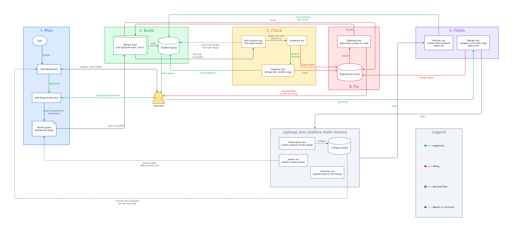

# Index

Design documentation and design bible for Ishikari, a workflow where AI agents
("ants") work in parallel to complete a task.

## Goal

Take any task from the user and finish it with many ants working in parallel.
The user is asked only once: the investigator ant's questions. Answering
them approves the whole run, merge to main included. The add requirement ant
only adds: it never asks. Build, check, fix, merge and upkeep run on their own, and the run ends
with one report.

Ishikari is a higher-order workflow: a plan can name another saved workflow as
its job. The build script runs that workflow in place of a worker ant.

## Flow

01. **Task in.** The user gives a task. It can be anything.

02. **Investigator Ant** has one goal: a bulletproof investigation report, so
    no later ant needs to ask. It critiques the task, finds the
    repo's test command and reads the critiques board: each critique that
    matters becomes a question. When it lacks facts it sends up to 5
    **Researcher Ants** in parallel; they search the web and the whole computer,
    read only, never secrets, and report back. It asks one question at a time,
    with `/ask-simple`, never a batch, and picks each question after the last
    answer. Each question shows a best-guess count: "Question 2 of about 5". It
    stops once nothing important is unclear, then writes
    `investigation_report.md` in the run's plans folder: goal, scope, every
    decision, facts with sources, constraints, risks, assumptions, acceptance
    checks and commands. Every claim cites an answer, a fact or the repo.

03. **Add Requirement Ant** only adds the requirement. It reads only the
    investigation report and the repo; where the report and its own idea
    differ, the report wins. It drafts the requirement with the
    `/add-requirement` skill and shows it can be built from the repo's code and
    docs, writing a throwaway spike outside the repo only when that is not
    enough. It never asks the user, and never designs or plans. The main session
    then commits the requirement and removes the critiques the user answered.

03b. **Architect Ant** reads the report and the requirement and writes
    `architecture.md` beside the report: the parts of the change, the files each
    part owns, and every name, interface and data shape that crosses between
    parts, so parallel workers fit together. It maps each acceptance check to
    the part that proves it, then writes one plan per worker ant.

04. **Plans.** Workers cannot ask questions, so each plan is complete. Tasks are
    split so no two edit the same file, and each task has its own test file.
    Only a task that must edit another task's file lists that task in `after`:
    it starts as soon as that task is built, on top of its branch. The plan
    script rejects unknown ids and loops in `after` before anything is built.

05. **Worker Ant** builds its plan in its own git worktree, at most 5 at a time.
    It decides on its own, goes as far as it can, and commits all its work,
    including the docs its change affects, so docs land with the code. A worker that gets stuck reports why, and that becomes a bug.

06. **Anti-monitor.** The build script itself does this job. It starts every
    ant, so it knows the moment a worker finishes and starts that task's
    inspector at once.

07. **Inspector Ant**: one per built task, started the moment the task or a
    fix for it is built. It reads only; it never changes code.
    - **Checks:** the task's own work against its plan, and against
      `architecture.md`: a name or interface that differs from the design is a
      bug. It runs the tests in the task's worktree.
    - **Pass:** no bugs. The task waits for the combined test. Style points go
      to the final report as notes.
    - **Fail:** each bug goes to the bug bounty board, with how to see it. It
      also writes the first fix plan, so round 1 needs no detective.
    - **Tasks built on others** are checked only once those are final. A
      changed base is merged in first; a failed base blocks the task.
    - **Re-check:** after each fix it checks every open bug again, by its id.

08. **Detective Ant**: finds why a bug is still open after a failed fix. It
    reads only; it never writes code.
    - **Round 1** needs no detective: the worker builds the inspector's first
      fix plan.
    - **Round 2 on:** for each bug still open, it finds the cause and writes
      the next fix plan. A worker ant builds it, and the inspector re-checks
      each open bug by its id.
    - **Memory:** each round sees every earlier round's cause, plan and
      outcome, so it never repeats a failed idea.
    - **Give up:** a bug still open after 3 tries drops the task, and tasks
      built on it drop too; the final report lists them.
    - An ant that crashes is retried once and never counts as a bug.

09. **Combined test, by the Integrator Ant.** Tasks are built and inspected
    alone, so two can pass alone and still break when combined. When every
    task is done, the integrator ant merges all passing tasks in a straight
    line in a scratch copy, a throwaway copy that never touches main, and runs
    the tests once. It is a dress rehearsal for the merger ant in Finish. A task
    that clashes takes in the tasks it clashes with and goes back through the
    fix loop, and the test runs once more. No one reviews by hand.

10. **Merger Ant** runs straight after. It adds every passing task's
    commits in a straight line, with no merge commits, in a scratch copy, in
    dependency order, and tests once. When the approved tasks are exactly the
    ones in the combined test, it reuses that result. It refuses a task whose base
    was dropped. A failed merge, or a task left waiting, goes back to a new
    build round on its own, at most 2 rounds; what is left is dropped and
    reported. Main moves forward only as a fast-forward, which git refuses if it
    would overwrite local edits.

## Upkeep ants

They run once per finish, on the merged result, before main moves.

- **Janitor ant** finds mess left by the merged tasks and writes a cleanup plan.
  The next plan stage offers it to the user as a task.
- **Philosopher ant** questions all the merged work together and keeps its 5
  best critiques. It only comments, in the critiques board, and never blocks. On
  the next task, the investigator ant turns the ones that matter into questions.

## Rules

- Ants work in parallel wherever nothing forces an order. Fix rounds, tasks in
  `after` and merges run in order.
- Only the main session asks the user questions, and only in the plan stage.
  Ants report problems in their results; after planning, the main session
  decides by the fixed rules in the skill and reports at the end.
- Only worker ants write code. Every other ant reads, plans, reviews, merges or
  posts to a board.
- At most 5 worker ants run at the same time, fix workers included. Upkeep ants
  and the ants of a saved workflow do not count.
- A worker ant never resets an existing branch: a fix round reuses the task's
  worktree and branch, so earlier work is never lost.
- Each run has its own id, and every branch is `ishikari/<run>/<task>`, so a new
  task never builds on an old task's branch.
- Ishikari keeps everything outside the repo, in its state folder
  `~/.ishikari/<repo>-<hash>/`: the boards, the plans, the worktrees and the
  saved commands. The only copy inside the repo is the scripts, under `.git`.
  None of it is ever committed, and the repo's main checkout is touched only by the
  final fast-forward.
- Only Ishikari's tool,
  [`ishikari.py`](../skills/ishikari/scripts/ishikari.py), writes the boards
  and the requirement entries.
  The scripts keep their rows while a stage runs and hand them to the tool once
  when the stage ends. The files in
  [`assets/boards/`](../skills/ishikari/assets/boards/) are the templates it
  starts from.
- Each ant thinks only as hard as its job needs: low for the board clerk,
  finisher and upkeep ants; medium for the investigator, researchers, add
  requirement ant, workers, inspectors and merger; high for the architect and
  the detective.

## Running Ishikari

A running workflow cannot stop to ask the user, so Ishikari is three workflows.
The main session asks the user only between the two plan runs, for the
investigator ant's questions; after that it drives everything on its own.

| Workflow          | Stages                      | Ends with            |
| ----------------- | --------------------------- | -------------------- |
| `ishikari-plan`   | review, plans               | plans to build       |
| `ishikari-build`  | build, check, fix, combined | tasks to merge       |
| `ishikari-finish` | merge, upkeep, main         | main moved, new bugs |

The scripts: [`ishikari-plan.js`](../skills/ishikari/scripts/ishikari-plan.js),
[`ishikari-build.js`](../skills/ishikari/scripts/ishikari-build.js) and
[`ishikari-finish.js`](../skills/ishikari/scripts/ishikari-finish.js).

The [`/ishikari`](../skills/ishikari/SKILL.md) command runs all four steps below
and stops to ask the user only in step 2.

1. Run `python3 scripts/ishikari.py setup <repo>`. It makes the state folder,
   copies the board templates, copies the three scripts into
   `<repo>/.git/ishikari/workflows/` where the Workflow tool may load them, and
   prints the run's `env`: repo, state folder, run id, main branch, tool path,
   script paths, and the repo's saved `testCommand` and `checkCommand`.
2. Run `ishikari-plan` with `env` and the task. While it returns a question,
   ask it alone with `/ask-simple`, then run again with every answer so far
   and the research findings; a skipped answer means "use the recommended
   one". The plans go straight to build. First
   `ishikari.py req add` writes the requirement (none for a refactor), the main
   session commits it, and `ishikari.py boards remove` drops the answered
   critiques. `ishikari.py config` saves the test and check commands.
3. Run `ishikari-build` with `env` and the plans. Every task
   `awaiting review` is approved without asking. Escalated, blocked and error
   tasks, and tasks built on them, are dropped and listed in the report.
4. Run `ishikari-finish` with `env`, the approved tasks, the build's `together`
   result (the combined test's) and any tasks to drop. One task with no `after` skips the trial
   merge: its inspector already tested it. After main moves, the finisher runs
   `checkCommand` to build and check the real app. Failed merges come back in
   the next build as `bugs`; the janitor's cleanup plan, based on main, goes to
   the next plan stage, and a cleanup run gets no janitor. The philosopher's
   new critiques are listed in the result. Once the check passes,
   `ishikari.py req done` marks the run's requirements DONE.

## Diagram

Stages run left to right: plan, build, check, fix, finish. Each board sits in
the stage that first writes to it; all boards live in the state folder, outside
the repo. D2 source: [`ishikari.d2`](ishikari.d2), rendered with the TALA layout
by [`render.sh`](render.sh) to a light and a dark SVG.

Colors: each stage has its own color. Green arrows are approvals, red arrows are
bugs, gray arrows are normal flow. Dashed arrows only watch or comment. The
legend in the diagram shows the arrow colors.

```d2
# Colors live in vars. render.sh swaps them for the dark version.
vars: {
  plan-fill: "#DBEAFE"
  plan-line: "#2563EB"
  build-fill: "#DCFCE7"
  build-line: "#16A34A"
  check-fill: "#FEF3C7"
  check-line: "#D97706"
  fix-fill: "#FFE4E6"
  fix-line: "#E11D48"
  finish-fill: "#EDE9FE"
  finish-line: "#7C3AED"
  always-fill: "#F1F5F9"
  always-line: "#64748B"
  node-fill: "#FFFFFF"
  text: "#0F172A"
  bug: "#DC2626"
  ok: "#16A34A"
  flow: "#475569"
}

classes: {
  node: {style: {fill: ${node-fill}; font-color: ${text}; stroke-width: 2}}
  bug: {style: {stroke: ${bug}; font-color: ${bug}; stroke-width: 2}}
  ok: {style: {stroke: ${ok}; font-color: ${ok}; stroke-width: 2}}
  flow: {style: {stroke: ${flow}; font-color: ${flow}}}
}

direction: right

user: User (me) {
  shape: person
  width: 80
  height: 80
  style: {fill: "#FDE68A"; stroke: "#B45309"; font-color: ${text}}
}

plan: 1. Plan {
  left: 0
  top: 0
  direction: down
  style: {fill: ${plan-fill}; stroke: ${plan-line}; font-color: ${plan-line}; stroke-width: 2}
  task: Task {shape: oval; class: node; style.stroke: ${plan-line}}
  arta: Investigator Ant {class: node; style.stroke: ${plan-line}}
  research: Researcher ants\nup to 5, web + computer {class: node; style.stroke: ${plan-line}}
  aara: Add Requirement Ant {class: node; style.stroke: ${plan-line}}
  arch: Architect Ant\narchitecture.md {class: node; style.stroke: ${plan-line}}
  plans: Worker plans\none per worker ant {shape: page; class: node; style.stroke: ${plan-line}; style.multiple: true}
  task -> arta: review {class: flow}
  arta <-> research: facts {class: flow; style.stroke-dash: 3}
  arta -> aara: investigation_report.md {class: ok}
  aara -> arch: requirement {class: flow}
  arch -> plans: design,\nwrite plans {class: flow}
}

build: 2. Build {
  left: 560
  top: 0
  style: {fill: ${build-fill}; stroke: ${build-line}; font-color: ${build-line}; stroke-width: 2}
  aw: Worker Ants\ncode, tests and docs,\none worktree each, max 5 {style.multiple: true; class: node; style.stroke: ${build-line}}
  bulletin: Bulletin board {shape: cylinder; class: node; style.stroke: ${build-line}}
  aw -> bulletin: built {class: flow}
}

check: 3. Check {
  left: 1440
  top: 0
  direction: down
  style: {fill: ${check-fill}; stroke: ${check-line}; font-color: ${check-line}; stroke-width: 2}
  monitor: Anti-monitor ant\n(the build script) {class: node; style.stroke: ${check-line}}
  inspector: Inspector Ants\none per built task,\nchecks plan + design,\nruns its tests {style.multiple: true; class: node; style.stroke: ${check-line}}
  together: Combined test\nIntegrator Ant\nmerges passing tasks\nin a scratch copy,\ntests once {class: node; style.stroke: ${check-line}}
  monitor -> inspector: start one as soon as\na task or fix is built {class: flow}
  inspector -> together: pass, once every\ntask is checked {class: ok}
}

fix: 4. Fix {
  left: 2350
  top: 0
  direction: up
  style: {fill: ${fix-fill}; stroke: ${fix-line}; font-color: ${fix-line}; stroke-width: 2}
  bounty: Bug bounty board {shape: cylinder; class: node; style.stroke: ${fix-line}}
  detective: Detective Ant\nfinds why a bug is still open\nafter a failed fix, writes the\nnext fix plan, never code {class: node; style.stroke: ${fix-line}}
  bounty -> detective: bug still open\nafter round 1 {class: bug}
}

finish: 5. Finish {
  left: 3000
  top: 0
  style: {fill: ${finish-fill}; stroke: ${finish-line}; font-color: ${finish-line}; stroke-width: 2}
  merger: Merger ant\nstraight line in a\nscratch copy, tests once {class: node; style.stroke: ${finish-line}}
  finisher: Finisher ant\nmoves main forward,\ncleans up {class: node; style.stroke: ${finish-line}}
}

always_on: Upkeep ants (before main moves) {
  left: 1700
  top: 700
  style: {fill: ${always-fill}; stroke: ${always-line}; font-color: ${always-line}; stroke-width: 2}
  janitor: Janitor ant\nwrites a cleanup plan {class: node; style.stroke: ${always-line}}
  philosopher: Philosopher ant\n5 best critiques of the merge {class: node; style.stroke: ${always-line}}
  philosopher -> critiques: critique {class: flow; style.stroke-dash: 3}
  critiques: Critiques board {shape: cylinder; class: node; style.stroke: ${always-line}}
}

plan.arta <-> user: one question\nat a time, /ask-simple {class: flow}
plan.plans -> build.aw: start in parallel {class: flow}
check.monitor -> build.bulletin: board tool writes\nonce per stage {class: flow; style.stroke-dash: 3}
check.together -> build.bulletin: pass: they\nwork combined {class: ok}
check.together -> fix.bounty: fail: tasks\nclash {class: bug}
check.inspector -> fix.bounty: fail: bugs +\nfirst fix plan {class: bug}
fix.detective -> build.aw: fix plan {class: flow}
build.aw -> check.monitor: fix built,\nre-inspect {class: flow}
fix.detective -> build.bulletin: dropped after\n3 tries on a bug {class: bug}
build.aw -> fix.bounty: stuck {class: bug}
build.bulletin -> finish.merger: passing tasks,\nno review {class: ok}
finish.merger -> fix.bounty: merge failed {class: bug}
finish.merger -> always_on: then {class: flow}
always_on -> finish.finisher: then {class: flow}
finish.finisher -> build.bulletin: main moved,\nset "done" {class: ok}
always_on.janitor -> plan.plans: cleanup plan,\noffered next time {class: flow; style.stroke-dash: 3}

legend: Legend {
  left: 3000
  top: 700
  grid-columns: 1
  grid-gap: 0
  style: {fill: ${always-fill}; stroke: ${always-line}; font-color: ${always-line}; stroke-width: 2}
  r1: "" {
    direction: right
    style: {fill: transparent; stroke: transparent}
    s: "" {shape: circle; width: 12; height: 12; style: {fill: ${ok}; stroke: ${ok}}}
    t: approval {shape: text; style.font-color: ${text}}
    s -> t {class: ok}
  }
  r2: "" {
    direction: right
    style: {fill: transparent; stroke: transparent}
    s: "" {shape: circle; width: 12; height: 12; style: {fill: ${bug}; stroke: ${bug}}}
    t: bug {shape: text; style.font-color: ${text}}
    s -> t {class: bug}
  }
  r3: "" {
    direction: right
    style: {fill: transparent; stroke: transparent}
    s: "" {shape: circle; width: 12; height: 12; style: {fill: ${flow}; stroke: ${flow}}}
    t: normal flow {shape: text; style.font-color: ${text}}
    s -> t {class: flow}
  }
  r4: "" {
    direction: right
    style: {fill: transparent; stroke: transparent}
    s: "" {shape: circle; width: 12; height: 12; style: {fill: ${flow}; stroke: ${flow}}}
    t: watch or comment {shape: text; style.font-color: ${text}}
    s -> t {class: flow; style.stroke-dash: 3}
  }
}
always_on.critiques -> plan.arta: turned into questions\nfor the next task {class: flow; style.stroke-dash: 3}
```

<picture>
  <source media="(prefers-color-scheme: dark)" srcset="ishikari-dark.svg">
  
</picture>

Animated version, one stage every 6 seconds:
[`ishikari-animated.svg`](ishikari-animated.svg), from
[`ishikari-animated.d2`](ishikari-animated.d2).

Car tour, one task driven slowly along the exact path it takes:
[`ishikari-flow.svg`](ishikari-flow.svg), built by [`flow.py`](flow.py). Open it
in a browser; it needs its script to run. It drives two routes: a bug fixed on
the first try, and a stuck worker dropped after 3 tries. The −, pause and +
buttons, or the keys `+`, `-` and space, change speed live. Click a block to see
only its arrows and the blocks they join; click it again, click empty space or
press Esc to go back to the tour.
