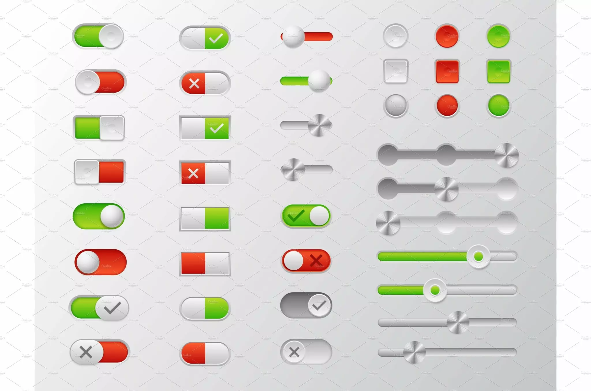

#+title: Component requirements
#+STARTUP: fold

The things a window is made of.
Part of the [[file:gui.org][GUI requirements]], which say what holds for all of it: the toolkit, the look, motion and performance.

* Need clear distinction between things that i can click or do action on and things i cant
* Interaction things in the app must be clear and distinct
* Buttons
** A reference shows one way to build them
- [[file:demo/cljfx/][demo/cljfx]] is a working reference in cljfx, not a library: an app follows what it does, and takes its code as an example
- The part worth copying is [[file:demo/cljfx/src/demo/ui.clj][ui.clj]], with the look in [[file:demo/cljfx/src/demo/glass.css][glass.css]]; [[file:demo/cljfx/src/demo/button.clj][button.clj]] is the demo's own page
- Its window checks, [[file:demo/cljfx/test/demo/window_check.clj][window_check.clj]], are the Verification lines below as code; an app's own checks ask the same
- The reference passes its own checks: =clojure -M:test= and =clojure -M:check=, run in =demo/cljfx=
- This requirement decides, not the reference: where the two differ, the reference is wrong
** Clickable things look like buttons
** One tinted glass button a page, the main action; every other toolbar button is regular glass, and a button in the page is plain
** Buttons answer a press
- Hover: the colour eases to its hover shade in 120 ms
- Press: the button sinks to 97% of its size and 1 px down, in 120 ms
- Hold: it stays sunk for as long as it is held
- Release: it springs back in 420 ms, overshooting a little before it settles
- Space on a focused button answers the same way as the mouse
- Return presses the main button, wherever the focus is; it sinks once and springs back
- While a question is open, as before a delete, Return presses nothing
- Dragged off while held it rises, and back over the button it sinks again; let go off the button, nothing fires
- Escape lets go of a held press: the button rises and nothing fires, until the mouse or the key is up
- Under Reduce Motion it only changes colour
** A held button fires its second action
- A button may have a second action, different from its click; a button with none only stays sunk
- Held for 500 ms, the second action fires, and letting go then does not fire the click as well
- A fill grows across the button while the hold counts, from 150 ms to 500 ms, so the second action is seen coming; a quick click is over before it shows
- Let go early and the fill fades away; under Reduce Motion it fades in where it would have grown
- A button with a second action shows a small mark at its trailing edge, so the action is not found by accident
- Its tooltip names both: what a click does and what a hold does
- The second action is also on the button's right-click menu, so the keyboard and a trackpad reach it
- A second action never deletes or overwrites; those stay a click that asks first
** Button states
- Focused: a ring in the accent colour, on keyboard focus
- Disabled: 45% opacity; it answers no hover, press or hold
- A disabled button's tooltip says why it is off
- Busy: while its action runs it shows a spinner beside its words and does not fire again; the words end in an ellipsis, "Saving…"
- A busy button does not sink or change colour on a press: it never looks as if it took one
- Done: the button says so with a tick for 1 s, "Saved", and takes no press meanwhile
- Failed: the button turns into "Retry" in red and stays so until pressed; its tooltip says what failed
- Going busy and back is smooth: the button glides to its new width in 220 ms while the spinner opens beside the words and fades in
- The words never blank, and neither the button nor its neighbours jump
- Under Reduce Motion the width changes at once and the spinner only fades
** Button kinds
- Main: tinted glass, one a page
- Plain: regular glass in a toolbar, a solid fill in the page
- Destructive: red words, never tinted and never the main one; they read at 4.5:1 like any others
- Icon and words: the icon leads
- Icon alone: a circle, with a tooltip that names it
** Button sizes
- Every button on a page is one height, 44 px
- A button's words stay on one line: they never wrap, and the button grows wide enough to hold them with its shortcut
- A button with words is 76 px wide or wider
- Buttons in a pair, as Cancel and Delete, are equal width: that of the wider
- Where a row runs out of room, it scrolls or moves buttons into a menu; it never squeezes one
** Verification
- A window check presses a button and reads its size: 100% at rest, 97% pressed, 97% after 1.5 s held, 100% once released
- It holds a button with a second action for 500 ms and counts one second action and no click
- It holds a button with no second action for 500 ms, lets go, and counts one click
- It presses a disabled button and counts nothing, with the size still 100%
- With Reduce Motion on, a press leaves the size at 100%
- It clicks a button that goes busy and reads its width 110 ms later: wider than at rest, narrower than once settled
- It reads the hold fill 300 ms into a hold: started, and not yet full
- It presses, sends a leave, an enter and a leave, and lets go: 100%, 97%, and nothing fired
- It presses, sends Escape and lets go: 100%, and nothing fired
- With the focus on another button it sends Return: the main button sinks and counts one click, and the focused one counts none
- It sends Space down, Escape, and Space up to a button: 97%, then nothing fired
- A window check reads the height of every button in each window and sheet: 44 px, all equal
- It narrows the window to its minimum width and reads each button: one line of words, 44 px tall
- It presses a busy button: 100%. It waits out the save: "Saved", then "Save"
- It makes a save fail: "Retry", nothing saved; it presses Retry and the save is counted
- It reads the tooltip of a disabled button and of one with a second action, and fires the right-click menu's item
- It reads the heights, the icon button's width, the words buttons' widths and a pair's two widths
- It draws each button without its words and reads the contrast of the words over the middle of it, at rest and under the pointer: 4.5 or more
- It counts frames through three presses and three busy glides: 55 a second or more
- With Reduce Motion on, it clicks a button that goes busy and reads its width 80 ms later: already settled
** Ideas
- Read: 
* Sliders
** A reference shows one way to build them
- [[file:demo/cljfx/][demo/cljfx]] is a working reference in cljfx, not a library: an app follows what it does, and takes its code as an example
- The part worth copying is [[file:demo/cljfx/src/demo/slider.clj][slider.clj]], with the look in [[file:demo/cljfx/src/demo/glass.css][glass.css]]; [[file:demo/cljfx/src/demo/slider_page.clj][slider_page.clj]] is the demo's own page
- Its window checks, [[file:demo/cljfx/test/demo/slider_check.clj][slider_check.clj]], are the Verification lines below as code; an app's own checks ask the same
- The reference passes its own checks: =clojure -M:test= and =clojure -M:check-slider=, run in =demo/cljfx=; =clojure -M:slider= opens it
- This requirement decides, not the reference: where the two differ, the reference is wrong
** A slider sets one value between two ends
- One thumb on a level track; the value is continuous, any point between the two ends
- A slider has a label that names what it sets, and a default value
- No stepped slider and no slider with two thumbs: a need for one is a new requirement
** A slider looks like a track and a glass capsule
- The track is 4 px to look at and 44 px to take hold of, the height of a button
- The thumb is a glass capsule, 28 by 20 px
- The track is filled in the accent colour from its start up to the thumb; the rest is plain
- A slider is 120 px wide or wider
- A notch on the track marks the default value
- Over the thumb the pointer is an open hand, and a closed hand while it drags
** The thumb answers a press
- Hover: the thumb eases to its hover shade in 120 ms
- Press: the thumb grows to 110% of its size in 120 ms, and stays so for as long as it is held
- Moving, the thumb stretches along the track, up to 36 px wide, and more the faster it moves; still again, it eases back in 220 ms
- Release: it springs back to 28 by 20 px in 420 ms, overshooting a little before it settles
- Under Reduce Motion it neither grows nor stretches; it only changes colour
** The thumb swings where it stops
- Stopped after a move, the thumb swings on past where it stopped, back short of it, and settles there, as a pendulum
- It stops when it is let go while moving, when it is held still for 40 ms in a drag, and at the end of its glide to a press on the track
- The first swing is 10% of how far the thumb moved, the same way: 100 px moved swings 10 px, 200 px swings 20 px; there is no most
- How far it moved is counted from the press or from the last stop, whichever is later, and is how far the thumb went: past an end, the pointer adds nothing
- A glide to a press on the track has moved the thumb as far as it glided
- Five swings, each about half the one before; the first is furthest out at 120 ms, and the last ends where the thumb rests, 1400 ms on
- The swing is only the thumb, its fill and its bubble: the value stays where the pointer put it, and so does what is written
- The thumb swings no further than either end
- A swing under 0.5 px is not shown, and let go after a stop, with no move since, it does not swing again
- A press on a swinging thumb catches it where it is drawn, and a drag goes on from there; let go without a move, it eases home in 420 ms
- A move, a press on the track, a double click or Escape ends a swing, and the thumb is where the value puts it
- A double click and the keyboard move the thumb without a swing
- Under Reduce Motion the thumb never swings
** A drag moves the thumb
- The thumb follows the pointer at once; a drag never glides, and swings only where it stops
- The drag goes on with the pointer above or below the slider, and off the window
- Past an end the thumb stops at that end, and takes up again when the pointer comes back
- Within 4 px of the notch the thumb snaps to the default value
- A press on the track, away from the thumb, glides the thumb to the pointer in 120 ms, swings there, and the same press goes on as a drag
- Under Reduce Motion the thumb lands there at once
- A double click puts the slider back to its default value; the thumb glides there in 120 ms, and at once under Reduce Motion
- Scrolling over a slider does not move it: the page under it scrolls
** A bubble shows the value while it changes
- At rest a slider shows no number
- While the thumb is held a bubble sits over it with the value in its unit, "40%", and follows it
- The bubble fades in over 120 ms on the press and out over 120 ms on the release
- After a key press it shows for 1 s
- The bubble is glass, and its words read at 4.5:1
- It is never clipped by the window's edge, nor by the edge of a scrolling area the slider is in: near one it slides sideways and stays whole, 4 px clear
- The slider's tooltip says the value too, so it is read without a change
** The value is written when the drag ends
- What the slider sets follows the thumb live, through the whole drag
- The value is written once, on the release, not at every move
- Escape during a drag puts the thumb and what it sets back to where the drag began, and writes nothing; the rest of that press does nothing
- One drag is one step for Undo, and so is a double click
- A double click on the track is one step too: its first click moves the thumb and is written, and the second, within 500 ms, joins that step
** The keyboard moves a focused slider
- Left and Down lower it by 1% of the range, Right and Up raise it by 1%
- With Shift they move it 10%
- Home goes to the low end and End to the high end
- Each key press writes the value; a held key writes once, when it is let go
- Key presses less than 1 s apart are one step for Undo
- A key at an end does nothing, and nothing is written
** Slider states
- Focused: a ring in the accent colour round the thumb, on keyboard focus
- Disabled: 45% opacity; it answers no hover, press, drag or key, and shows no bubble
- A disabled slider's tooltip says why it is off
** Verification
- A window check sends its events the way a pointer does
- It drags the thumb to the middle, holds it still and reads the value: half the range; and the thumb 100 ms later: past the pointer, by no more than 10% of the move; and 1.1 s on: under the pointer
- It reads the value written during the drag and after letting go: nothing, then the value
- It reads what the slider sets halfway through a drag: already following
- It drags past each end and reads the value: the low end, the high end, and no further
- It drags, sends Escape and lets go: the value from before the drag, and nothing written
- It presses the track away from the thumb and reads the thumb 30 ms later: left its place, not yet under the pointer; 280 ms on: past the pointer, by no more than 10% of the glide; 1.8 s on: under the pointer; then it drags on and the thumb follows
- It drags to 3 px from the notch and reads the value: the default; and to 6 px from it: not the default
- It reads the notch's place and the fill's width: at the default, and up to the thumb
- It double clicks and reads the value: the default, written once
- It scrolls over the slider and reads the value and the page: the value as before, the page moved
- It reads the thumb's size at rest, held, 1.5 s held and once released: 100%, 110%, 110%, 100%
- It reads the thumb's width in a fast drag and once settled: wider than 28 px, then 28 px
- It reads the bubble at rest, held, and after the release: none, the value in its unit, none
- It drags to each end and reads the bubble's edges: inside the window, and at the low end no longer centred on the thumb
- It sends Right, Shift+Right, Home and End to a focused slider and reads the value after each: up 1%, up 10%, the low end, the high end
- It sends Left at the low end and counts nothing written
- It sends Right down five times and up once: moved 5%, written nothing until the key is up, then once
- It sends Right three times and reads the steps for Undo: one; it sends Undo and reads the value from before them
- It drags once, sends Undo and reads the value: the one before the drag
- It presses, drags and sends keys to a disabled slider: the value as before, no bubble, the thumb at 100%; and reads its opacity: 45%
- It reads the pointer over the thumb and during a drag: an open hand, a closed hand
- It reads the thumb's colour under the pointer, and its edge on keyboard focus: changed, and the accent colour
- It reads each slider's label: what it sets
- With Reduce Motion on, it presses the thumb and reads its size: 100%; it presses the track and reads the thumb 20 ms later: already under the pointer
- It reads the heights, the track's thickness, the thumb's size and the slider's width
- It reads the tooltip of a slider and of a disabled one
- It draws the bubble without its words and reads the contrast of the words over the middle of it: 4.5 or more
- It counts frames through three drags and three track presses: 55 a second or more
* Time pickers
** A reference shows one way to build them
- [[file:demo/cljfx/][demo/cljfx]] is a working reference in cljfx, not a library: an app follows what it does, and takes its code as an example
- The part worth copying is [[file:demo/cljfx/src/demo/time_picker.clj][time_picker.clj]], with the look in [[file:demo/cljfx/src/demo/glass.css][glass.css]]; [[file:demo/cljfx/src/demo/time_picker_page.clj][time_picker_page.clj]] is the demo's own page
- Its window checks, [[file:demo/cljfx/test/demo/time_picker_check.clj][time_picker_check.clj]], are the Verification lines below as code; an app's own checks ask the same
- The reference passes its own checks: =clojure -M:test= and =clojure -M:check-time-picker=, run in =demo/cljfx=; =clojure -M:time-picker= opens it
- This requirement decides, not the reference: where the two differ, the reference is wrong
** A time picker sets one time of day
- One field that is typed into, with a list of times under it; the value is an hour and a minute, any minute of the day
- A time picker has a label that names what it sets
- Where the time is optional the field may be empty, and then shows a hint in grey, "9:30 AM"
- Where it is not, an emptied field is not taken: the line under it says "Not a time. Try 9:30 or 2130"
- No date, no seconds, no time zone, no pair of a start and an end, no ready-made choices such as "In 1 hour", no clock face and no wheels: a need for one is a new requirement
** A time picker looks like a field
- The field is 44 px tall, the height of a button, and 120 px wide or wider
- The time is shown the way macOS is set to show it: "9:30 AM", or "09:30" on a 24-hour clock
- macOS's own 24-hour switch decides; with it unset, the region's habit does
- On a 12-hour clock twelve o'clock is shown with its word, "12:00 PM, noon" and "12:00 AM, midnight", in the field and in the list
- Over the field the pointer is a text cursor
** Typing sets the time
- Focus selects all of the field's text, so typing replaces it
- These are all taken: "9a", "930a", "9:30 am", "9.30p", "9p", "2130", "21:30", "noon", "midnight"; in either case, with or without a space
- Both the 12-hour and the 24-hour forms are taken, whatever macOS is set to show
- An hour from 1 to 12 with no AM or PM is never guessed at: "3", "3:30", "930" and "12" are not taken, and the line under the field asks "AM or PM? Type 3a or 3p"
- An hour from 13 to 23, and 0, is taken as it stands on the 24-hour clock
- Where macOS shows a 24-hour clock every hour is taken as it stands: "3" is 03:00
- Return, Tab or a click elsewhere takes what is typed, and the field then shows it in full: "930a" becomes "9:30 AM"
- Minutes past 59, hours past 23, and AM or PM after an hour of the 24-hour clock, "13p", are not a time
- What cannot be read as a time is not guessed at: the text stays, the field's edge turns red, a line under it says "Not a time. Try 9:30 or 2130", and nothing is written
- Typing again clears the red edge and the line
** A list offers times
- The list opens under the field on a click in it, on typing, and on Down; Tab into the field does not open it
- It holds the day in 15 minute steps, eight rows to be seen and the rest scrolled to
- It opens with the field's time marked and in the middle; from an empty field, with the step after now
- Typing narrows it: "2" leaves 2:00 PM, 2:15 PM, 2:30 PM and 2:45 PM, then the same four in the AM, with no row marked, so either half of the day is two keys away
- Text that is a whole time is the first row, and marked: "207p" shows "2:07 PM" first, though it is on no step
- Up and Down move the mark, Return takes the marked row, and a click takes the row under it
- With no row marked, Down marks the first row and Up the last, and Return takes what is typed
- Up and Down never step the time by a minute: an exact minute is typed
- Text that offers nothing, "abc", closes the list
- The list is as wide as the field, and never narrower than "12:00 AM, midnight" needs
- Escape closes an open list and leaves the typed text; a second Escape puts the field back to the time it had
- The list is glass, and its words read at 4.5:1
- It is never clipped by the window's edge: with no room under the field it opens over it, and it stays whole, 4 px clear
- Scrolling over the open list scrolls the list; over the field alone, the page under it scrolls and the time does not change
- The list opens and closes with a 120 ms fade, and at once under Reduce Motion
** The time is written when it is taken
- The time is written once, when it is taken, not at every key
- Taking the time the field already had writes nothing
- Escape writes nothing
- One taken time is one step for Undo
- Command-Z while text is typed undoes the typing, in the field; with nothing typed it is the app's Undo
** Time picker states
- Focused: a ring in the accent colour, on keyboard focus
- Disabled: 45% opacity; it answers no click and no key, and opens no list
- A disabled time picker's tooltip says why it is off
- Not a time: a red edge and the line under it, until the text changes or Escape puts the old time back
** Verification
- A window check sends its keys and clicks the way a person does
- It gives the field the focus and reads what is selected: all of its text
- It types each of "9a", "930a", "9:30 am", "9.30p", "9p", "2130", "21:30", "noon" and "midnight", sends Return, and reads the field and the written time after each
- It types "3" and sends Return, and again with "3:30": the text still there, a red edge, "AM or PM? Type 3a or 3p", nothing written
- It empties a field that is not optional and sends Return: the line under it, nothing written
- It types "13" and "0" and reads the times: 1:00 PM and midnight
- It reads what is written while it types and after Return: nothing, then the time, once
- It types "abc" and sends Return: the text still there, a red edge, the line under it, nothing written; it types a digit and the edge and the line are gone
- It types, sends Escape twice, and reads the field: the time from before, nothing written
- It takes the time the field already had and counts nothing written
- It types "6p" and clicks elsewhere on the page: 6:00 PM, written
- It clicks the field and reads the list: open, eight rows to be seen, the field's time marked and in the middle
- It sends Tab into the field and reads the list: closed; it sends Down: open
- It types "2" and reads the rows: 2:00 PM first, eight rows in all, none marked; it types "207p" and reads the first row: 2:07 PM, marked
- It types "2" and sends Up: the last row is marked
- It types "2", sends Down three times and Return and reads the time: the third row's, 2:30 PM
- It clicks a row and reads the time, and the list: that row's, and closed
- It puts the field at the window's bottom edge, opens the list and reads its edges: inside the window, over the field
- It scrolls over the open list and over the field alone: the list moved, then the page moved and the time as before
- It sets a 24-hour clock and reads the field: "09:30"; it types "9p" and reads "21:00"; it types "3" and reads "03:00"
- It reads the field and the list's row at twelve: "12:00 PM, noon" and "12:00 AM, midnight"
- It empties an optional field and reads the hint and what is written: "9:30 AM" in grey, and no time
- It takes a time, sends Undo and reads the field: the time from before
- It clicks and sends keys to a disabled time picker: the time as before, no list; and reads its opacity: 45%
- It reads the field's height and width, and its edge on keyboard focus: the accent colour
- It reads the tooltip of a disabled time picker
- It draws the list without its words and reads the contrast of the words over the middle of it: 4.5 or more
- It opens the list and reads it 40 ms later: fading in; with Reduce Motion on, 20 ms later: fully there
- It counts frames through three openings of the list: 55 a second or more
** Decided
- On 2026-11-13, by the owner, from three choices:
- An hour alone is asked about, not guessed: chosen over a daytime guess, 7 to 11 AM and 12 to 6 PM, and over whichever comes next on the clock, which gives a different answer at different times of day
- One time only: a start and an end together is a new requirement
- No quick buttons such as "Now" or "In 1 hour": they can be added later as a new requirement
- Up and Down move through the list, and do not step the minute
** Ideas
- Why a typed field and not a dial: [[https://www.nngroup.com/articles/date-input/][NN/g on date input]], [[https://material.io/blog/24-hour-clock-design-research][Material's 24-hour clock research]], [[https://developer.apple.com/design/human-interface-guidelines/pickers][Apple's pickers guidance]]
- Why a short list and words for twelve: [[https://jan.miksovsky.com/posts/2010/10-11-reconsidering-stock-controls-to-create-an-optimized-user-experience][Miksovsky on time dropdowns]], [[https://www.timeanddate.com/time/am-and-pm.html][Time and Date on AM and PM]]
* OPEN Date pickers
:PROPERTIES:
:ID: date-pickers
:CREATED: 2026-11-15
:LAST_EDITED: 2026-11-15
:APPROVED: 2026-11-15
:VERIFY: clojure -M:test (demo.date-picker-test), clojure -M:check-date-picker (demo.date-picker-check), run in demo/cljfx
:END:
** A reference shows one way to build them
- demo/cljfx gets date_picker.clj, the part worth copying, and date_picker_page.clj, the demo's page, styled in glass.css
- =clojure -M:date-picker= opens it; =clojure -M:check-date-picker= runs its window checks
- This requirement decides, not the reference
** A date picker sets one day
- One field that is typed into, with a month calendar under it; the value is a year, a month and a day
- A date picker has a label that names what it sets
- Where the date is optional the field may be empty, and then shows a hint in grey, "Fri, 20 Nov 2026"
- No time, no time zone, no range of a start and an end, no words such as "tomorrow" or "next fri": a need for one is a new requirement
** A date picker looks like a field
- The field is 44 px tall, the height of a button, and 180 px wide or wider, with a calendar mark at its right end
- The date is shown the way macOS's region shows a medium date, with the weekday: "Fri, 20 Nov 2026"
- Over the field the pointer is a text cursor; over the calendar mark it is an arrow
** Typing sets the date
- Focus selects all of the field's text, so typing replaces it
- These are all taken: "20 nov", "nov 20", "20 November 2026", "2026-11-20", and the region's short form, "20/11/2026" or "11/20/2026"; in either case
- A day and month with no year is the next such day from today, today included
- Return, Tab or a click elsewhere takes what is typed, and the field then shows it in full
- What is not a date, "31 Nov" or "abc", is not guessed at: the text stays, the edge turns red, a line under it says "Not a date. Try 20 Nov or 2026-11-20", and nothing is written
- Typing again clears the red edge and the line
** A calendar offers days
- The calendar opens under the field on a click in the field or on its mark, and on Down; Tab into the field does not open it
- It shows one month: its name and year, the weekday initials, and six weeks at most; days of the months either side are dim and can be taken
- The week starts on the day macOS's region starts it
- It opens on the field's month with its day marked; from an empty field, on today's month with today marked
- Today has a ring in the accent colour; the taken day is filled with it
- ‹ and › go a month back and on; Page Up and Page Down do the same from the keyboard
- The arrow keys move the mark a day or a week, into the next month where needed; Return takes the marked day, and a click takes the day under it
- "Today" at its foot marks and takes today
- Escape closes an open calendar and leaves the typed text; a second Escape puts the field back to the date it had
- The calendar is glass, its words read at 4.5:1, it is never clipped by the window's edge, and it opens and closes with a 120 ms fade, at once under Reduce Motion
** The date is written when it is taken
- The date is written once, when it is taken, not at every key or mark move
- Taking the date the field already had writes nothing; Escape writes nothing
- One taken date is one step for Undo
** Date picker states
- Focused: a ring in the accent colour, on keyboard focus
- Disabled: 45% opacity; it answers no click and no key, opens no calendar, and its tooltip says why it is off
- Not a date: a red edge and the line under it, until the text changes or Escape puts the old date back
** Verification
- A unit test reads each typed form above, and "31 Nov", "abc" and an empty field, into a date or a refusal
- A unit test reads a day and month with no year against a fixed today: the next such day
- A window check types "20 nov" and sends Return: the field reads "Fri, 20 Nov 2026" and the date is written once
- It types "31 Nov" and sends Return: the text still there, a red edge, the line under it, nothing written
- It clicks the field: the calendar open on the field's month, its day marked, today ringed
- It sends Right, Down and Return: the day eight days on is taken
- It sends Page Down: the next month shown; it clicks a dim day: that day taken
- It clicks "Today": today taken, the calendar closed
- It sends Escape twice after typing: the date from before, nothing written
- It takes a date, sends Undo: the date from before
- It sets a Monday-first region and reads the first weekday column: Monday
- It clicks and sends keys to a disabled date picker: no calendar, the date as before, 45% opacity
- It reads the field's height and width, the calendar's edges at the window's bottom, and the contrast of its words: 44 px, 180 px or more, inside the window, 4.5 or more
- It opens the calendar and reads it 40 ms later: fading in; with Reduce Motion on, 20 ms later: fully there
Evidence: JavaFX 27.0.1, in demo/cljfx/deps.edn, ships javafx/scene/control/DatePicker.class and com/sun/javafx/scene/control/DatePickerContent.class (a month grid on java.time.LocalDate and WeekFields); requirements/demo/cljfx/src/demo/time_picker.clj already builds a typed glass field with a list under it and its window checks in test/demo/time_picker_check.clj; mockup shown and approved on 2026-11-15
* DONE Scroll areas and scroll bars
:PROPERTIES:
:ID: scroll-areas
:CREATED: 2026-11-14
:LAST_EDITED: 2026-11-14
:APPROVED: 2026-11-14
:IMPLEMENTED: 2026-11-14
:VERIFY: clojure -M:test (demo.scroll-test), clojure -M:check-scroll (demo.scroll-check), run in demo/cljfx
:END:
** A reference shows one way to build them
- [[file:demo/cljfx/][demo/cljfx]] is a working reference in cljfx, not a library: an app follows what it does, and takes its code as an example
- The part worth copying is [[file:demo/cljfx/src/demo/scroll.clj][scroll.clj]], with the look in [[file:demo/cljfx/src/demo/glass.css][glass.css]]; [[file:demo/cljfx/src/demo/scroll_page.clj][scroll_page.clj]] is the demo's own page
- Its window checks, [[file:demo/cljfx/test/demo/scroll_check.clj][scroll_check.clj]], are the Verification lines below as code; an app's own checks ask the same
- The reference passes its own checks: =clojure -M:test= and =clojure -M:check-scroll=, run in =demo/cljfx=; =clojure -M:scroll= opens it
- This requirement decides, not the reference: where the two differ, the reference is wrong
** A scroll area shows content larger than its room
- A scroll area is a fixed room with content that moves inside it, up and down, sideways, or both
- It scrolls only along an axis where the content is larger than the room; along the other it does not move, and shows no bar
- Content never draws outside its scroll area, over a sidebar, a toolbar or another panel
- The window scrolls nothing as a whole: each panel that can overflow is its own scroll area, and the sidebar, the toolbar and the page each scroll on their own
- [[file:gui.org::*A wide table scrolls sideways in its own area][A wide table scrolls sideways in its own area]] is one of these, and holds to all of this
** macOS's scroll settings are followed
- System Settings, Appearance, "Show scroll bars" decides when the bars show: on scrolling only, always, or by what is plugged in, as macOS decides it
- "Click in the scroll bar to" decides what a click in the track does: go a page, or go to the spot clicked; Option and a click does the other
- The scroll direction is macOS's, natural or not; the app never turns it round
- A change to any of these takes hold within 1 s, with no restart
** A scroll bar looks like a thin capsule
- The knob is a capsule, its length the room's share of the content, and never shorter than 24 px
- Its place along the track is the room's place along the content
- Shown only when scrolling, the bar floats over the content at its edge, with no track: the knob is 7 px thick, 3 px in from the edge
- With the pointer over the bar, the knob grows to 11 px and a track shows under it, in 120 ms
- Shown always, the bar takes its own 15 px beside the content, with a track, and the content is that much narrower; where both bars show, a square fills the corner
- In the dark theme the knob is light on dark, and reads at 3:1 or more against what is under it
- No arrow buttons at the ends of a bar
- Over a bar the pointer is the arrow, not a hand
** A scroll bar shows while it is needed
- Shown only when scrolling, a bar shows the moment its area scrolls, and fades out over 300 ms once 1 s has passed with no scroll and no pointer over it
- It shows too, for 1 s, when its area first appears or its content grows, so it is seen that there is more
- With the pointer over the bar's 16 px edge it stays, and fades 1 s after the pointer leaves
- Faded out, a bar is not there for a click; its 16 px edge is, and brings it back
** The trackpad and the wheel scroll the area under the pointer
- A swipe or the wheel scrolls the area under the pointer, not the one with the focus
- The content follows the fingers at once, one to one, with no lag and no smoothing added
- A trackpad scroll moves by the pixel and stops wherever the fingers leave it, never snapping to a line or a row
- Let go with speed, it glides on and slows to a stop, as macOS's own areas do; a touch on the trackpad stops the glide where it is
- A notched wheel moves the content a line, 40 px, a notch, eased over 100 ms; at once under Reduce Motion
- A sideways swipe scrolls sideways; Shift and the wheel do too
- A swipe more along one axis than the other keeps to that axis for the rest of the gesture, so a down swipe does not drift sideways
** The edge gives, then springs back
- A trackpad swipe past an end pulls the content on, less and less the further it goes, and lets go back to the end in 300 ms, as a rubber band
- A glide that reaches an end bounces there in the same way
- A notched wheel stops at the end, with no give
- The pull is never more than a third of the room
- Under Reduce Motion the pull still follows the fingers, since they move it, but a glide stops at the end with no bounce
** A scroll inside a scroll goes to the right one
- A gesture stays with the area it started in until the fingers lift and its glide ends, even when that area reaches its end
- A new gesture over an inner area that is at its end, pushing on past it, scrolls the area round it
- A gesture along an axis an inner area cannot scroll goes at once to the area round it: an up swipe over a wide table scrolls the page
- Over a control that is not a scroll area, a slider or a closed time picker, the area under it scrolls
** A drag on the knob moves the content
- A press on the knob holds it, and the content follows the pointer at once, keeping where on the knob it was taken
- The drag goes on with the pointer off the bar and off the window, and never jumps back
- Past an end the knob stops, and takes up again when the pointer comes back
- Escape during a drag puts the content back where the drag began
- A press in the track, away from the knob, goes a page that way, or to the spot clicked, as macOS is set; held, it goes on a page each 100 ms until the knob is under the pointer
- A page is the room less one line, 40 px, so the last line seen is still there
** The keyboard scrolls a focused area
- With the focus in an area and not in a text field, Up and Down scroll a line, Left and Right a line sideways
- Page Up and Page Down, Space and Shift and Space go a page; Option and Up or Down go a page too
- Home and End go to the top and the bottom; Command and Up or Down do too
- A key scroll eases over 150 ms, and is at once under Reduce Motion; a held key scrolls on smoothly, with no steps
- In a text field these keys move the caret, and the area follows the caret
** What is wanted is brought into sight
- A control given the focus by Tab, out of sight, is scrolled into sight with 16 px clear of the edge, by the least that does it
- A row chosen by the keyboard, a search hit, or a thing jumped to from the command palette is scrolled into sight the same way
- A drag held within 24 px of an area's edge scrolls it that way, faster the nearer the edge, for drag and drop and for choosing many rows
- The area never scrolls on its own otherwise: new content arriving does not move what is in view
** The place is kept
- Content that changes above what is in view, from a live reload or rows added, does not move what is in view: the first row seen stays where it was
- A scroll area added at the end of a list it shows to the bottom, such as a log, stays at the bottom while it is there, and stays put once scrolled up
- Each page's scroll place is kept as it is left, and is there on going back to it, and between runs
- Resizing the window keeps the first row seen in place
** Content scrolls under glass
- Content scrolls on under a glass toolbar or bar, and is seen through it, as the glass layer floats over it
- Where content meets the edge of glass, it softens and fades over 16 px, so words under it never clash with the bar's words
- At the top, with nothing scrolled under, the edge shows no fade
** Scrolling stays at the frame rate
- A scroll is drawn at the screen's frame rate, 55 a second or more, with any amount of content
- Only the rows in view, and a screen's worth either side, are built; a list of 100,000 rows scrolls as a list of 100 does
- Scrolling never waits on loading: a row whose data is not yet there shows its place, and fills when it comes, off the UI thread
- Images and heavy rows that come into view draw without a stutter
** Verification
- A window check sends its scrolls, presses and keys the way a pointer and a keyboard do
- It reads an area whose content fits: no bar, and a scroll moves nothing
- It sets each of macOS's "Show scroll bars" choices and reads the bar: floating and 7 px with no track, or 15 px beside the content with a track
- It scrolls and reads the bar: there at once; and 1 s on with no scroll: still there; and 1.4 s on: gone
- It moves the pointer over the bar's edge and reads the knob: 11 px, a track under it; it reads it 2 s on: still there
- It reads the knob's length against the room's share of the content, for a short and a very long content: in step, and never under 24 px
- It sends a slow trackpad swipe of 7 px over a list of 32 px rows and reads the place once still: moved 7 px, not on a row's edge
- It sends a trackpad swipe with speed and reads the place as it glides and once still: moving on, then stopped further than the swipe went
- It sends a swipe past the bottom and reads the place: past the end by no more than a third of the room; and 400 ms after the lift: at the end
- It sends a wheel notch at the bottom: no give
- It sends a down swipe with a little sideways drift over an area that scrolls both ways: no sideways move
- It sends Shift and the wheel: a sideways move
- It sends a swipe over an inner area until its end, without lifting: the outer area as before; then a new swipe: the outer area moved
- It sends an up swipe over a wide table: the page moved, the table as before
- It drags the knob halfway and reads the place: half the content; it drags off the window and back: no jump
- It drags the knob, sends Escape and reads the place: where the drag began
- It clicks the track with each of macOS's click choices, and with Option: a page, the spot clicked, and the other
- It holds a press on the track and reads the place 500 ms on: paged on until the knob is under the pointer, no further
- It sends Down, Page Down, Space, End and Home to a focused area and reads the place after each: a line, a page less a line, a page less a line, the bottom, the top
- It sends Tab to a control out of sight and reads its edges: in the room, 16 px clear
- It holds a drag 10 px from the bottom edge and reads the place over 500 ms: moving down
- It adds rows above what is in view and reads the first row seen: the same row, at the same place
- It leaves a page scrolled, goes elsewhere, comes back, and reads the place: as left; and again after a restart
- It scrolls content under the glass toolbar and reads the pixels under it: content seen, fading at the glass's edge
- With Reduce Motion on, it sends Page Down and reads the place 20 ms later: already a page on; it sends a glide into the end: no bounce
- It reads the knob's contrast over light and dark content: 3 or more
- It counts frames through three swipes and three glides over a 100,000 row list: 55 a second or more
- It counts rows built while a 100,000 row list scrolls: a screen's worth and the rows either side, never all
** Decided
- On 2026-11-14, by the owner:
- Under Reduce Motion the edge still stretches under the fingers, with no bounce: chosen over a hard stop, and over the same bounce as with it off
- The scroll place is kept between runs, not only while the app is open
- A log stays at its newest line while it is at the bottom, and that is part of this requirement, not one of its own
- The sizes and times stand: a 7 px bar, 11 px under the pointer, 15 px when always shown, a fade after 1 s, 40 px a wheel notch
- No screen reader or VoiceOver support, as [[file:gui.org::*No screen reader or VoiceOver support][the GUI requirements]] say
- A change to macOS's scroll settings takes hold within 1 s, not at once: the app is not told of the change, and looks for it every 500 ms
- On 2026-11-14 the owner tried the reference by hand with a real trackpad, its swipes, glides, edges and bars, and found it good: what the window checks send as a trackpad's events holds for a real one
** Ideas
- [[https://developer.apple.com/design/human-interface-guidelines/scroll-views][Apple's scroll views guidance]]
- A way to jump far, such as a letter index or a date strip beside a long list, is a new requirement
- Zoom by pinch in a scroll area is a new requirement
* Status bar at the bottom :optional:
* Message bar at the bottom :optional:
