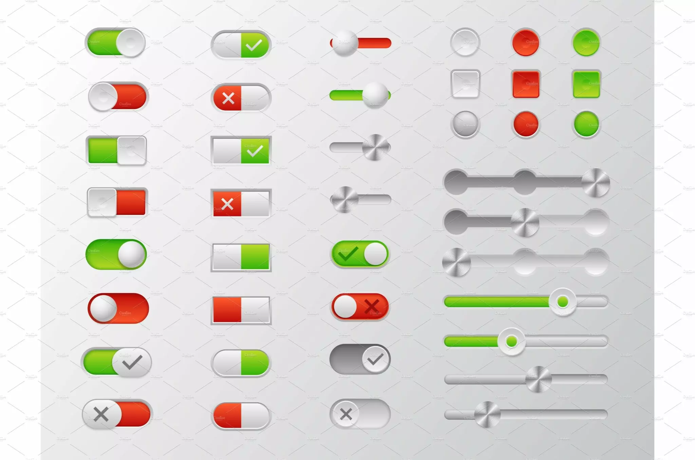

#+title: Component requirements
#+STARTUP: fold

The things a window is made of.
Part of the [[file:gui.org][GUI requirements]], which say what holds for all of it: the toolkit, the look, motion and performance.

* Need clear distinction between things that i can click or do action on and things i cant
* Interaction things in the app must be clear and distinct
* Buttons
** A reference shows one way to build them
- [[file:demo/cljfx/][demo/cljfx]] is a working reference in cljfx, not a library: an app follows what it does, and takes its code as an example
- The part worth copying is [[file:demo/cljfx/src/demo/ui.clj][ui.clj]], with the look in [[file:demo/cljfx/src/demo/glass.css][glass.css]]; [[file:demo/cljfx/src/demo/button.clj][button.clj]] is the demo's own page
- Its window checks, [[file:demo/cljfx/test/demo/window_check.clj][window_check.clj]], are the Verification lines below as code; an app's own checks ask the same
- The reference passes its own checks: =clojure -M:test= and =clojure -M:check=, run in =demo/cljfx=
- This requirement decides, not the reference: where the two differ, the reference is wrong
** Clickable things look like buttons
** One tinted glass button a page, the main action; every other toolbar button is regular glass, and a button in the page is plain
** Buttons answer a press
- Hover: the colour eases to its hover shade in 120 ms
- Press: the button sinks to 97% of its size and 1 px down, in 120 ms
- Hold: it stays sunk for as long as it is held
- Release: it springs back in 420 ms, overshooting a little before it settles
- Space on a focused button answers the same way as the mouse
- Return presses the main button, wherever the focus is; it sinks once and springs back
- While a question is open, as before a delete, Return presses nothing
- Dragged off while held it rises, and back over the button it sinks again; let go off the button, nothing fires
- Escape lets go of a held press: the button rises and nothing fires, until the mouse or the key is up
- Under Reduce Motion it only changes colour
** A held button fires its second action
- A button may have a second action, different from its click; a button with none only stays sunk
- Held for 500 ms, the second action fires, and letting go then does not fire the click as well
- A fill grows across the button while the hold counts, from 150 ms to 500 ms, so the second action is seen coming; a quick click is over before it shows
- Let go early and the fill fades away; under Reduce Motion it fades in where it would have grown
- A button with a second action shows a small mark at its trailing edge, so the action is not found by accident
- Its tooltip names both: what a click does and what a hold does
- The second action is also on the button's right-click menu, so the keyboard and a trackpad reach it
- A second action never deletes or overwrites; those stay a click that asks first
** Button states
- Focused: a ring in the accent colour, on keyboard focus
- Disabled: 45% opacity; it answers no hover, press or hold
- A disabled button's tooltip says why it is off
- Busy: while its action runs it shows a spinner beside its words and does not fire again; the words end in an ellipsis, "Saving…"
- A busy button does not sink or change colour on a press: it never looks as if it took one
- Done: the button says so with a tick for 1 s, "Saved", and takes no press meanwhile
- Failed: the button turns into "Retry" in red and stays so until pressed; its tooltip says what failed
- Going busy and back is smooth: the button glides to its new width in 220 ms while the spinner opens beside the words and fades in
- The words never blank, and neither the button nor its neighbours jump
- Under Reduce Motion the width changes at once and the spinner only fades
** Button kinds
- Main: tinted glass, one a page
- Plain: regular glass in a toolbar, a solid fill in the page
- Destructive: red words, never tinted and never the main one; they read at 4.5:1 like any others
- Icon and words: the icon leads
- Icon alone: a circle, with a tooltip that names it
** Button sizes
- Every button on a page is one height, 44 px
- A button with words is 76 px wide or wider
- Buttons in a pair, as Cancel and Delete, are equal width: that of the wider
** Buttons and the screen reader
- Every button has the role of a button and a name; an icon alone is named in words
- macOS is given a JavaFX control's name, role and the word for its kind, and nothing else: no help text, and not whether it is on. What must be said goes in those
- A second action is said in the name, "Add 1. Hold: Add 10", and is reached without holding, from the right-click menu
- A disabled button is called a dimmed button, and its name says why it is off
- What macOS is given is read from macOS itself, not from the toolkit: [[file:demo/cljfx/tools/ax_tree.swift][ax_tree.swift]] prints it for a running app
** Verification
- A window check presses a button and reads its size: 100% at rest, 97% pressed, 97% after 1.5 s held, 100% once released
- It holds a button with a second action for 500 ms and counts one second action and no click
- It holds a button with no second action for 500 ms, lets go, and counts one click
- It presses a disabled button and counts nothing, with the size still 100%
- With Reduce Motion on, a press leaves the size at 100%
- It clicks a button that goes busy and reads its width 110 ms later: wider than at rest, narrower than once settled
- It reads the hold fill 300 ms into a hold: started, and not yet full
- It presses, sends a leave, an enter and a leave, and lets go: 100%, 97%, and nothing fired
- It presses, sends Escape and lets go: 100%, and nothing fired
- With the focus on another button it sends Return: the main button sinks and counts one click, and the focused one counts none
- It sends Space down, Escape, and Space up to a button: 97%, then nothing fired
- It presses a busy button: 100%. It waits out the save: "Saved", then "Save"
- It makes a save fail: "Retry", nothing saved; it presses Retry and the save is counted
- It reads the tooltip of a disabled button and of one with a second action, and fires the right-click menu's item
- It reads each button's role and name, and the second action's spoken help
- It reads the heights, the icon button's width, the words buttons' widths and a pair's two widths
- It draws each button without its words and reads the contrast of the words over the middle of it, at rest and under the pointer: 4.5 or more
- It counts frames through three presses and three busy glides: 55 a second or more
- With Reduce Motion on, it clicks a button that goes busy and reads its width 80 ms later: already settled
** Ideas
- Read: 
* Status bar at the bottom :optional:
* Message bar at the bottom :optional:
