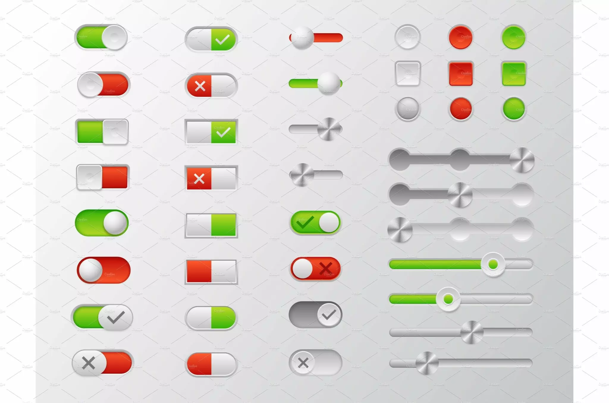

#+TITLE: GUI

Not all of this is applicable to all apps. So pick and choose which is necessary for a well designed and performant app.

Every feature implemented must have atleast 1 test for it. 1 test can cover more than 1 feature.

Before starting UI/UX design follow the principles mentioned in this book - [[file:~/Library/Mobile Documents/com~apple~CloudDocs/Shared_Documents/Work/Books/Design/Laws of UX - Using Psychology to Design Better Products - Jon Yablonski - \[2nd Ed \], 2024.epub][Laws of UX - Using Psychology to Design Better Products - Jon Yablonski - [2nd Ed ], 2024]].

* General
- Research the web when you plan
- Plan before implementation
* Coding Guidelines
- Follow KISS (Keep it simple stupid) philosophy
- Less code better than more code
- Fast code is better than slow code
- No code is better than bad code
* The app must have a Window
** A window can have multiple Tabs feature
** Can have Multi window support
** If the window have panes then it must be resizable
- The divider between two panes drags to resize them, whether they sit side by side (width) or one above the other (height)
- Each pane has a smallest and a largest size
- The size is remembered between runs; one kept outside the limits comes back within them
** In a narrow window the sidebar shrinks to icons only and side panels hide
* Performance
** App must run at 60 fps
** Scrolling must be smooth
** Stability of the app is important
** Never compromise performance for visuals
** Slow work runs off the UI thread
* Appearance
** Dark Theme
* Animation
** Animation types
*** Glide
*** Smooth
*** Bounce
*** Rubber Band
*** Pop-up
*** Spinner
*** Progress bar
*** Lift
** Animation where possible
*** On hover
*** pop-up
*** Drop down menu
*** Button
- Hover
- Press
- Hold
- Release
*** etc...
** The progress bar and spinners must be smooth
** Buttons answer a press
- A button eases its colour on hover, sinks slightly on press and springs back on release
- Every button answers, but not a disabled one
- Under Reduce Motion it only changes colour
** Reduce Motion is respected
- With the system's Reduce Motion setting on, things fade and never slide
* Behaviour
** The app must react to my actions
** Whatever is running shows a spinner beside the words that say what it does
* Features
** A way to restart the app
- Restarts the way it was started, on the same data
- Unsaved scratch work is saved first
** Save and restore state/session
- Reopens at the same window position and size
- Same tabs, screen and page as when it was left
* UI/UX
** Alignment, positioning and centering must be proper
** Add a native file menu
** The menu bar and the sidebar are each one list in the requirements
- Each is written down once, as a tree in its own requirement, in order
- A change that adds, moves, renames or removes an item updates that tree in the same change, so it always says what is there
- The sidebar's groups are the menu's, in the same order, so the two never disagree
** Try to follow native os style.
** Use dividers and seperators where applicable
For example:
- Between panes
- Between sections
** Use icons when possible
** Lists
- Each page remembers its view and sort between runs
- Any sort can be reversed
- Rows with no value sort last, whichever way the sort runs
- In a table, a click on a column heading sorts by that column: first click its natural way, second click reversed, third click back to no sort
- The sorted heading shows an arrow, ↓ its natural way and ↑ reversed; a click on another heading starts that column at its first click
** A wide table scrolls sideways in its own area
- A table wider than its room scrolls sideways inside its own area, and never draws over the sidebar or another panel
- The first column stays in place; the other columns and their headings slide under it, together
- A scroll bar shows along the table's foot only while the table is wider than its room; a sideways swipe, or Shift and the wheel, scrolls it too
- Sorting and choosing a row still work wherever it is scrolled to, and keep the sideways position
** Tooltip as needed
* Editing
** Cut, Copy and Paste text
** Undo and Redo
- Undo reverses the newest change, file writes included
- Redo makes again what undo took back, until a new change is made
** Text boxes need to have full featured editor support
** Delete asks first
- A sheet says what will be deleted, with Delete and Cancel; Delete is red, and Return does not press it
- Deleted files go to the Trash, not away for good
- A delete is one change, so one undo brings everything back
** A field error blocks Save, and invalid input is never written
* Pages
** Settings page must have side bars where the settings are organized by category
** History page that shows the pages navigated recently
** Back and forward retrace pages visited, like a browser: keys, menu and mouse side buttons
* Things
** Need clear distinction between things that i can click or do action on and things i cant
** Interaction things in the app must be clear and distinct
** Buttons
- Clickable things needs to look like buttons
- One filled, coloured button a page, the main action; every other button is outlined
- Ideas
  - Read: 
** Status bar at the bottom :optional:
** Message bar at the bottom :optional:
* Text and Fonts
** Use diffrent fonts as needed
** Use different sizes as needed
- I should be able to adjust font size with keybinding
- I should be able to set default font size in settings page
- Autosave current font size as default font size on quit
** Use different styles like bold, italics, headings, comments etc. as needed.
** Choose font based on function and purpose.
** Monospace for code and plain text.
** Syntax highlight code always
** Pick colors that enhance readability
** Default font size for app is 16
** Widths sized for text grow with the font size, so no label clips
** Fonts need to look crisp and clear and easy to read.
** Text must fit entirely within its container, with no clipping.
* Keyboard
** Allow rebind of keys and shortcuts in settings
** The app must have keyboard shortcuts
- Every common action has a key
- Unmodified keys work only when no text box has focus
** A command palette (⌘K) reaches every action, screen and item
* Mouse
** The mouse pointer appearance should change based on the thing below it while hovering, clicking or acting on that thing
** Must support multi thing selection when applicable
- ⌘-click adds or removes one thing from the selection; ⇧-click selects a run
- An action on everything selected is one change, so one undo takes it all back
** Must support drag and drop when applicable
** The pointer should animate when applicable
** Context menu where needed
* Data
** Data lives seperately from the code
- Code and data live in separate repositories
- The data folder is configurable
** Changes made to the data files outside the app show live, after 150 ms of quiet, with no restart
** Try not not to store data unless it is necessary and performance critical
** Data that can be computed should be computer
** Compute rather than store
For example: Age. It can be calculated from date of birth. So no need seperate field for age.
** Cache locally when possible
*** Cache all data which can be to be cached
*** Show loading screen during caching and wait till all data is cached locally.
*** Allow force refresh of cache
*** If caching involves downloading from internet then decide at what intervals.
Don't cache on every app start or you may hit bandwidth or api issues
* Testing
** Write automated tests where sensible
** Take screenshots or record a video of yourself for testing the app when automated test is not possible.
Use this as a last resort.
** Testing should not hinder development speed
* Development
- When applicable use REPL during development
