# Index

Design documentation and design bible for Ishikari, a workflow where AI agents
("ants") work together to complete a task.

## Goal

Take any task from the user and finish it with many ants, one at a time unless `--parallel` is passed.
The user is asked only by one ant: the investigator, while it plans. Answering
them approves the whole run, merge to main included. The investigator writes two
specs, a product spec and a tech spec, and one plan per worker. Build, check, fix, merge and upkeep run on their own,
and the run ends with one report.

Ishikari is a higher-order workflow: a plan can name another saved workflow as
its job. The build script runs that workflow in place of a worker ant.

## Flow

01. **Task in.** The user gives a task. It can be anything.

02. **Investigator Ant** does all the planning: it asks, proves the task can
    be built, and writes two specs and every worker plan. The product spec,
    `product_spec.md`, says what the product does: behaviours and invariants,
    nothing else. The tech spec, `tech_spec.md`, says the architecture and the
    code's shape. No other ant plans, so nothing is lost between ants. It is one live agent for the whole talk, run
    by the skill, not a workflow, on Fable at max effort: it reads the repo
    once and gets each answer as a message. Ishikari needs the Agent tool for
    it; without it the run stops at the start. It works in two parts.

    **Part 1: investigate.** It critiques the task and finds the repo's test
    command. When it lacks facts it sends up to 5 **Researcher Ants** in
    parallel, on Opus at low effort; they search the web and the whole
    computer, read only, never secrets, and report back. A fact about a user
    interface they judge with the `/ux` skill in review mode; its plan mode
    asks the user, so they never use it. It asks up to 4 independent questions
    at a time with `/ask-simple`, with a best-guess count: "Questions 1-3 of
    about 5", 8 in all. Once nothing important is unclear it writes
    `product_spec.md` in the run's plans folder. It holds two lists and nothing
    else. Behaviours: what the product does once the task is done, each with
    an id (`B1`, `B2`...) and written as given / when / then. Invariants: what
    must always hold, each with an id (`I1`, `I2`...). Both are written so an
    ant can check them. Each answer the user gave shows up as the behaviour it
    led to; there is no goal, background, decisions log or assumptions list.
    A task that changes no behaviour (a refactor, docs) has invariants only.
    Then it gives its trivial verdict and waits.

    **Fast path.** Trivial means a small, known scope (1-2 files), no design
    choice and one task; docs or config only helps but is not needed, and any
    question asked makes it not trivial. On a trivial verdict the skill asks
    the user once to confirm. Yes: the main session builds from the product spec
    alone: it edits on a branch in a
    worktree, runs the test and check commands there, fast-forwards main only
    when both pass, logs one `fast path landed` entry through `ishikari.py`,
    and stops the investigator. If the work turns out bigger or a check keeps
    failing, it throws the edits away and tells the same investigator to go
    on, with the reason; a `fast path escalated` entry is logged.

    **Part 2: tech spec and plans.** Told to go on, it first proves the task can
    be built, from the repo's code and docs, writing a throwaway spike outside
    the repo only when that is not enough. If it cannot be built as asked, or
    the design needs a choice only the user can make, it asks again, within
    the same 8 questions; only when no answer can fix it does the run stop
    with the reason. An answer that changes what the product does goes into
    the product spec. Then it writes `tech_spec.md` beside it: the parts of
    the change, the files each part owns, and every name, interface and data
    shape that crosses between parts, so parallel workers fit together. It
    maps every behaviour and invariant id to the part that delivers it, then
    writes one plan per worker ant; each plan names the ids it covers.
    It writes nothing to the logbook itself: it runs outside any workflow, and
    the main session never writes the logbook. `ishikari-plan` logs one
    `investigated` entry for it, with the product spec's path; its researchers
    are not logged.

03. **Plan check.** `ishikari-plan` runs no ant: it only checks the
    investigator's plan list. Before anything is built it rejects bad or
    unknown ids, loops in `after`, two tasks that edit one file without one
    being after the other, and paths outside the repo. It also checks
    coverage: every behaviour and invariant id is covered by at least one
    plan, every plan covers at least one, and no plan names an id the product
    spec does not have. File paths are
    normalised first, so `./a.py` and `a.py` count as one file. Problems go
    back to the same investigator once; it fixes the plans and the check runs
    again. Still wrong: the run stops with the reason. The investigator is
    stopped only when its plans pass.

04. **Plans.** A plan is one worker's thin slice of the two specs, never a
    copy: its files, the spec ids it covers, the interfaces it uses by name,
    its tests and the test command. Workers cannot ask questions, so the specs
    hold the detail and the worker reads them. A run with one worker has no
    plan file: the worker builds straight from the specs. Tasks are
    split so no two edit the same file, and each task has its own test file.
    A folder and a file inside it count as the same file, and so do two names
    that differ only by case. The ids `fast` and `check-fix` are Ishikari's own.
    Only a task that must edit another task's file lists that task in `after`:
    it starts as soon as that task is built, on top of its branch.

05. **Worker Ant** builds its plan in its own git worktree, one at a time by default: a
    single worker or detective runs at any moment. `--parallel <n>` lets up to
    n (at most 5) run at once.
    It decides on its own, goes as far as it can, and commits all its work,
    including the docs its change affects, so docs land with the code. A worker
    that gets stuck reports why, and that becomes a bug.

06. **Detective Ant**: one per built task, started the moment the task or a
    fix for it is built. No ant watches for that: the build script starts every
    ant, so it starts the detective as soon as the worker returns. It checks
    the task and plans every fix; it never changes code.
    - **Checks:** the task's own work against its plan, and against
      `tech_spec.md`: a name or interface that differs from the tech spec is a
      bug. It runs the tests in the task's worktree.
    - **Pass:** no bugs. The task waits for the combined test. Style points go
      to the final report as notes.
    - **Fail:** it returns each bug, with how to see it, its cause and a fix
      plan. A worker ant builds the plan, and the detective re-checks every
      open bug by its id and plans the next fix for any still open. The build
      script keeps the bugs and hands them on; the logbook only records them.
    - **Memory:** each re-check sees every earlier round's cause, plan and
      outcome, so it never repeats a failed idea.
    - **Tasks built on others** are checked only once those are final. A
      changed base is merged in first; a failed base blocks the task.
    - **Give up:** a bug still open after its last try drops the task, and tasks
      built on it drop too; the final report lists them.
    - An ant that crashes is retried once and never counts as a bug.

07. **Combined test, by the Integrator Ant.** Tasks are built and inspected
    alone, so two can pass alone and still break when combined. When every
    task is done, the integrator ant merges all passing tasks in a straight
    line in a scratch copy, a throwaway copy that never touches main, and runs
    the tests once. It is a dress rehearsal for the merger ant in Finish. A task
    that clashes takes in the tasks it clashes with and goes back through the
    fix loop, and the test runs once more. No one reviews by hand.

08. **Merger Ant** runs straight after. It adds every passing task's
    commits in a straight line, with no merge commits, in a scratch copy, in
    dependency order, and tests once. It may reuse the combined test's merge
    (see [Finish](../SKILL.md#4-finish)). It refuses a task
    whose base was dropped. A failed merge, or a task left waiting, goes back
    to a new build round on its own; what is left after the last round is
    dropped and reported. Main moves forward only as a fast-forward, which git
    refuses if it would overwrite local edits.

## Upkeep ants

They run once per finish, on the merged result, before main moves.

- **Janitor ant** runs first and finds mess left by the merged tasks, and only that: dead
  code, bloat, duplication. It does the cleanup itself, with no other ant: in
  its own worktree on top of the merged scratch copy it edits, runs the tests,
  commits, writes a short note of what it changed, and fast-forwards the scratch
  copy to its cleanup only if the tests pass. The cleanup then lands as its own
  commits after the tasks, in the same main move. Tests failing: it is dropped,
  main moves with the tasks alone, the cleanup branch is kept and the next plan
  stage hands its note to the investigator ant, which may ask about it. One cleanup per finish: a dropped cleanup's own run gets
  no janitor, so cleanups never chain. A small run gets no janitor either: under 100
  lines added or changed, by the merger's `git diff --shortstat`.
- **Judge ant** gives the final verdict. It runs after the janitor's cleanup has
  landed or been dropped, reads the product spec and the merged code with the
  cleanup on top, and scores the whole run 0-10 on one question, id by id:
  does the code behave as each behaviour says, and does each invariant hold?
  The tech spec and the plans are not what it scores: detectives check those.
  It lists each gap as a concrete fix, naming the id. With three or more tasks it
  delegates first: one **Juror ant** per task, one at a time (up to 5 at once
  with `--parallel`), each scoring
  its task against that task's plan. The judge weighs their reports, checks
  how the tasks fit together and decides the score itself; it is not an
  average. One or two tasks: the judge works alone. Below
  7 with gaps, one fix round per finish: a worker ant closes the gaps on top of the
  merged scratch copy, a detective ant checks it, runs the tests and, only if
  both pass, fast-forwards the scratch copy to it itself (the only way the fix
  lands), and the judge scores again. At 7 or more the same round runs only
  for the gaps the judge lists as bugs: wrong behaviour, never a missing test
  alone. Still below 7, or the fix failed (its branch is kept
  and the verdict says why): main moves anyway and the verdict is
  flagged in the report. The judge never blocks main, so a run never gets
  stuck on a score: main always moves.
- **Docs ant** runs last, on the final code. It uses the `/docs` skill in
  update mode in its own worktree: it changes only files under `docs/` or
  `doc/` and Markdown or Org files elsewhere, never code, tests or data, and
  never asks the user (open questions go in the docs' Open questions
  chapter). It runs the docs' own `build.sh diagrams` and `check` when
  present, then the tests, commits, and fast-forwards the scratch copy only if
  all pass. The script reads its list of changed files and refuses the landing
  if one is not a docs file. No `docs/` or `doc/` folder: it does nothing,
  since creating docs needs the user. Failed: its branch is kept, main moves
  without it, and nothing chains to the next run.

Upkeep work counts as landed only when the ant says so, its checks passed and
it names the new commit. Anything else is put back: a merger ant resets the
scratch copy to the last checked commit, since the ant may have moved it before
failing or dying. If that reset fails, the rest of upkeep is skipped. Main
moves to the last checked commit, never to a branch by name. A later finish of
the same run uses its own upkeep branches (`_docs-2`, `_cleanup-2`,
`_judgefix-2`), so a branch kept by an earlier finish is never removed.

## Retrospective ant

The last ant of every run that got past setup, run once by the main session after
everything else, however the run ended: main moved, stopped, blocked or error.
A fast path that landed gets none. It judges the Ishikari flow, not the repo's
code: wasted or repeated ant calls, retries and loops, dead ants, slow stages,
plans or prompts that misled an ant, weak or missing checks, rules that did not
fit, bugs and errors in the flow. It reads this run's logbook entries, the plans
folder (product spec, tech spec, worker plans, cleanup note and every
stage result the main session saved as `<stage>-<n>.json`), the run's git
history and Ishikari's own source. Every finding cites evidence from the run.
It is read only, and the script checks it: a digest of the repo's refs,
worktrees and status must be the same before and after. Its one write is `retrospective.md` in the run's plans folder,
outside the repo, ranked costliest first, each finding with its category (bug,
error, inefficiency, gap, missing, improvement), evidence, impact, suggested
change and the Ishikari file and rule to change. The final report shows its
summary and top 3 findings; the user decides what to act on.

## Rules

- Workers, detectives and jurors run one at a time unless the user passes
  `--parallel <n>`; then they work in parallel wherever nothing forces an order. Fix rounds, tasks in
  `after` and merges run in order.
- Only the main session asks the user questions, and only in the plan stage.
  Ants report problems in their results; after planning, the main session
  decides by the fixed rules in the skill and reports at the end.
- Only worker ants and the janitor ant write code; the docs ant writes only
  docs. Every other ant reads,
  plans, reviews, merges or records to the logbook.
- At most 5 worker ants run at the same time, fix workers included. Upkeep ants
  and the ants of a saved workflow do not count.
- A worker ant never resets an existing branch: a fix round reuses the task's
  worktree and branch, so earlier work is never lost.
- Each run has its own id, and every branch is `ishikari/<run>/<task>`, so a new
  task never builds on an old task's branch.
- Ishikari keeps everything outside the repo, in its state folder
  `~/.ishikari/<repo>-<hash>/`: the logbook, the plans, the worktrees and the
  saved commands. The only copy inside the repo is the scripts, under `.git`.
  None of it is ever committed, and the repo's main checkout is touched only by the
  final fast-forward.
- Only Ishikari's tool,
  [`ishikari.py`](../scripts/ishikari.py), writes the logbook.
  Each write holds a lock, so two runs never lose
  each other's entries; the logbook is only ever appended to. Lock files live in `~/.ishikari/locks`, never in the repo.
- Every workflow ant's reply is logged the moment it comes, in plan, build,
  finish and the retrospective, through a logbook clerk ant, one clerk at a time: replies that come
  while it writes wait in a queue and go in its next append; a failed append never blocks or fails
  the run. A dead clerk is retried once; entries it still could not write come
  back in the stage result as `logLost`, and the main session appends them. The live investigator gets only the `investigated` entry
  `ishikari-plan` logs for it. Build and finish also append a summary at the
  end of the stage.
- Never trust an ant's answer shape. The scripts check every reply: a missing
  or broken field is an error, never a silent pass, and an ant call that throws
  counts as a dead ant, never a lost stage. A built task needs a commit of its
  own. The main session checks that the product spec, the tech spec and every plan file
  the investigator names exist, before the plan check runs.
  A task merged in an earlier finish counts as in main by `git cherry` or the
  main session's `landed` list, never by an ancestor check: main holds copies. A combined test counts only
  when every task is reported merged and a commit is given. Main counts as moved
  only when something was merged and the finisher says so. Branch names from
  earlier rounds must look like `ishikari/<run>/<task>`, since they go into git
  commands; a scratch branch (its name starts with `_`) is never a task. Paths,
  the main branch and the test and check commands go into the ants' shell
  commands too: setup and every script let through only letters, digits and
  `. _ / + -` in paths, and one-line commands with no backtick.
  The main session never passes on a question the investigator already asked,
  or a ninth one.
- A logbook entry with an
  unknown field, or without run, who or event, is refused, and a newline in a
  value never starts a new field.
- A dropped task's branch is kept, never deleted, so its work can be looked at
  later. Only merged tasks' branches and scratch branches are removed.
- Every ant runs on the latest Opus model at low effort, its researchers
  included, but one: the investigator runs on Fable at max effort, since the
  whole run stands on its two specs and its plans. Each script keeps a per-ant
  EFFORT table and a MODEL setting, so one ant can be tuned later.

## Running Ishikari

A running workflow cannot stop to ask the user, so Ishikari is four workflows.
The main session asks the user only while the live investigator plans, for
its questions; after that it drives everything on its own.

| Workflow          | Stages                      | Ends with            |
| ----------------- | --------------------------- | -------------------- |
| `ishikari-plan`   | plan check, no ant          | plans to build       |
| `ishikari-build`  | build, check, fix, combined | tasks to merge       |
| `ishikari-finish` | merge, upkeep, main         | main moved, new bugs |
| `ishikari-retro`  | retrospective               | ranked improvements  |

The scripts: [`ishikari-plan.js`](../scripts/ishikari-plan.js),
[`ishikari-build.js`](../scripts/ishikari-build.js),
[`ishikari-finish.js`](../scripts/ishikari-finish.js) and
[`ishikari-retro.js`](../scripts/ishikari-retro.js).

The [`/ishikari`](../SKILL.md) command runs all five steps below
and stops to ask the user only in step 2.

1. Run `python3 scripts/ishikari.py setup <repo>`. It makes the state folder,
   starts the logbook if there is none, copies the four scripts into
   `<repo>/.git/ishikari/workflows/<run>/` where the Workflow tool may load them
   (one copy per run, so a later setup never swaps a running script), and
   prints the run's `env`: repo, state folder, run id, main branch, tool path,
   script paths, and the repo's saved `testCommand` and `checkCommand`.
2. The live investigator asks its questions and writes the product spec, the
   tech spec and the plans; `ishikari-plan` then checks the plans (see
   [Plan](../SKILL.md#2-plan)). The plans go straight to
   build. `ishikari.py config` saves the test and check commands.
3. Run `ishikari-build` with `env` and the plans. Every task
   `awaiting review` is approved without asking. Escalated, blocked and error
   tasks, and tasks built on them, are dropped and listed in the report.
4. Run `ishikari-finish` with `env`, the approved tasks, the build's `together`
   result (the combined test's) and any tasks to drop. One task with no `after`
   skips the trial merge: its detective already tested it. After main moves, the finisher runs
   `checkCommand` to build and check the real app; a failed check comes back
   once as a `check-fix` task built from the moved main. Failed merges and
   waiting tasks come back in the next build as `bugs`. Tasks merged while
   main did not move (`notMoved`) are approved again in the next finish. The
   main session never takes the finisher's word: it asks git whether main
   holds the checked commit. The
   janitor makes, tests and commits its cleanup inside finish, and it lands
   with the tasks; only a dropped cleanup's plan goes to the
   next plan stage, and that cleanup run gets no janitor. The judge's
   verdict (score, gaps, flagged) is in the result. The skill's
   [Limits](../SKILL.md#limits) table is the source of truth
   for every loop cap.
   The docs ant updates the docs last, after the judge. The main session
   saves every stage result with `ishikari.py save`.
5. Run `ishikari-retro` with `env` and how the run ended. The retrospective
   ant writes `retrospective.md`; the final report adds its top findings.

## Diagram

Stages run left to right: plan, build, check, fix, finish. The scripts hand work
from ant to ant directly. The Logbook sits apart: a shared ledger, one plain
text recfile per repo, `~/.ishikari/<repo>-<hash>/logbook.rec`, outside the
repo. It is append only: nothing in it is ever changed or removed. In the
map's words: logbook clerk ant: appends each ant's entry the moment the ant
replies, one clerk at a time, in plan, build, finish and the retrospective. The live investigator gets only an
investigated entry. Build and finish add a summary at the end. No ant reads it.
Each entry says who, the task and what came of it (built, 2 bugs found, score
6, died); the clerk appends it while the run goes on, and a failed append never
blocks or fails the run. The live investigator runs outside any workflow, so
`ishikari-plan` logs one `investigated` entry for it, with the product spec's path. The
summaries hold each task's status, each bug with its tries, the cleanup, the
judge's verdict and whether main moved. The cost: at most one small clerk
call per ant call, fewer when replies arrive together. You add your own notes with `ishikari.py log note`; they are notes,
never orders. Read it with `ishikari.py log status` (each
task's latest event), `recsel` or any editor.

An animated metro map drawn as one open ring: a run reads clockwise from Task
at the top, round to the Run report just before it. The gap at the top says a
run ends there; the next one is yours to start. The blue stretch is asking and
planning, the indigo stretch is build, check, fix, merge and judge, and the
green stretch is after main moves. Loops and spurs bend inside the ring (the
fix loop, the clash line, the judge's fix round, the fast path straight across
to MAIN), and each spur names the station it goes to. Station names sit
outside the ring; the title and the key sit in the middle. Every agent label in the four scripts has a
station, helper ants included (the judge-fix worker and detective, the jurors), and short notes name each skipped step. Built by
[`metro.clj`](metro.clj), a Babashka script; run `bb metro.clj` after a flow change.
The map draws names only, to stay simple; every description and short
rule lives in the item's tooltip and click panel. Everything on the map says
what it is: stations, lines, spurs, junctions,
the three part labels in the corners, the moving cars and the key. Hover for a one-line tooltip;
open the SVG itself in a browser and click for a panel with the full story
(Esc closes it). Lines and notes take their text from `about-lines` and
`about-notes` in `metro.clj`; the build fails on one without text.
Each station has a fixed id (`merger`) and a position code worked out on
each build (`s9`: the 9th stop, counted clockwise from Task), shown small beside its name. A station whose ant uses skills lists every one
after that, in indigo (`/ask-simple`); they live in `station-skills` in `metro.clj`.
`ishikari-metro.svg#merger` or `#s9` opens that station's panel. Its text
lives in `details` in `metro.clj`, keyed by id; spurs name their target by
id too. The build fails on a missing detail, a duplicate id or a spur to an
unknown station.
`test_metro_map` in [`test_ishikari.py`](../tests/test_ishikari.py) checks it
against the scripts.

